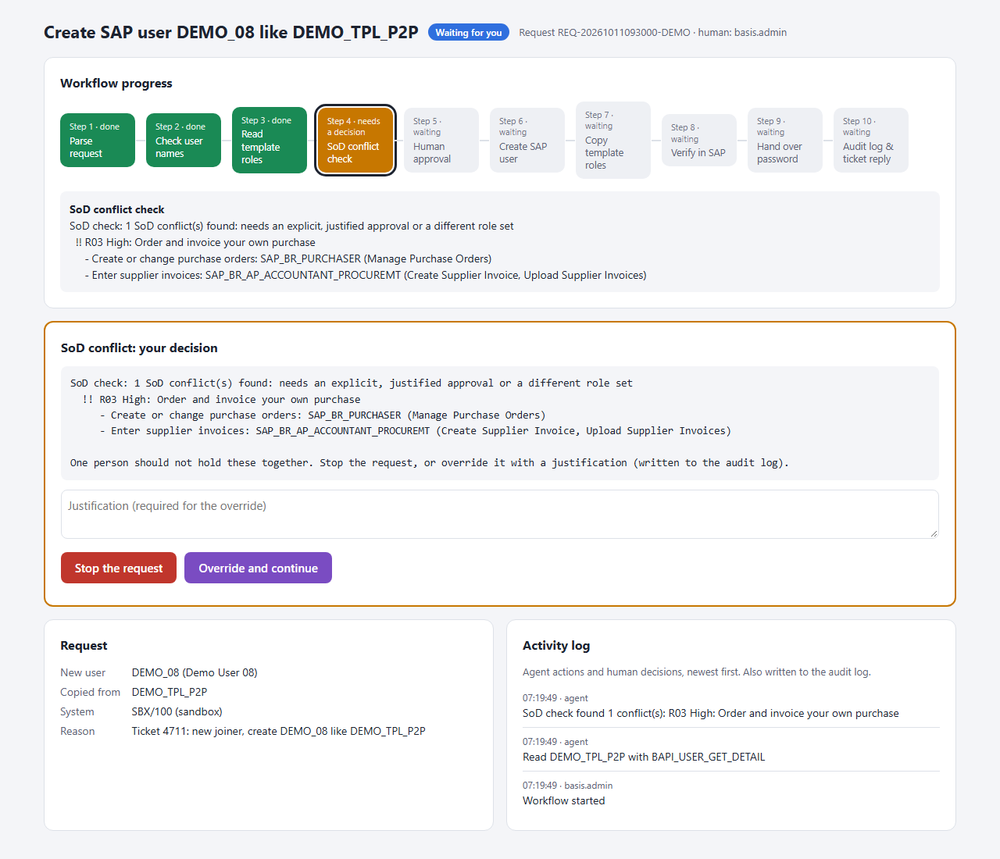
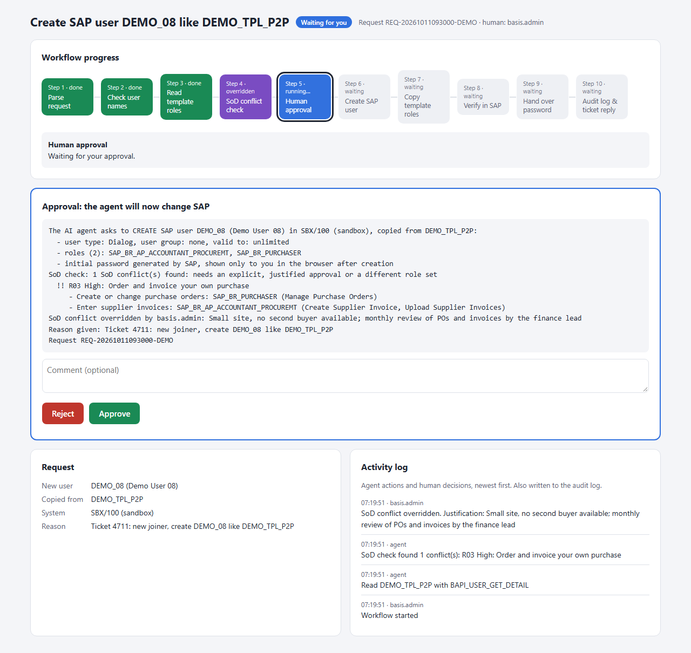
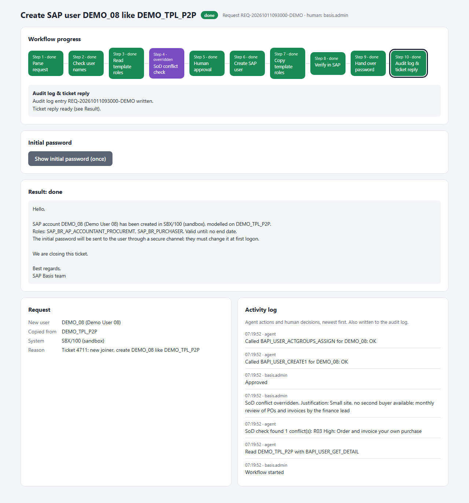

# SAP Basis Agent

An AI agent that handles routine SAP Basis user administration (the small, repetitive tickets that eat a Basis team's day) by calling **standard SAP BAPIs** through an **MCP server**. A human still decides: every change needs a person to approve it, risky role combinations are flagged, and everything is logged.

> "New joiner, ticket 4711: create DEMO_08 like DEMO_TPL_P2P."
> "Give DEMO_03 the role SAP_BR_INVENTORY_MANAGER until 31 December."
> "Why can't DEMO_06 log on? Answer in French."

The agent picks the right tool, fills in the parameters, runs the read-only checks, and prepares the change. The human approves it in the browser, SAP does the work, the result is checked, and the agent hands back a ticket reply ready to paste.

**Proof of concept** on a sandbox SAP S/4HANA demo system with test users only. Not hardened for production.

## Why this is more than "a BAPI behind MCP"

Wrapping BAPIs in MCP is the easy part. Governance decides whether an action should happen at all. This POC answers some of those questions in a simple way:

| Question | What the POC does |
|---|---|
| Who decides? | The AI proposes and a **human approves** every write action on a browser page. Without a "yes", nothing changes in SAP. |
| Is this role combination risky? | A **segregation-of-duties (SoD) check** runs before a user is copied or a role is added, for example *create purchase orders* + *enter supplier invoices*. If there is a conflict, the human must **stop** the request or **override** it with a written justification. |
| What happened, and who asked? | An **audit log** records who was at the keyboard, the reason given, the human decision, the BAPIs called and the **verified** result, read back from SAP afterwards. |
| Does the AI see passwords? | No. SAP generates initial passwords, and they are shown only to the human in the browser, never to the AI. |
| Did it really work? | After every change the agent reads the user back from SAP and reports what is actually there. |

## See it in action

For the bigger requests (create user like, add roles, deactivate leavers), a **workflow page** opens in the browser and shows each step live: checks, SoD, approval, SAP calls and verification. The human decides at each checkpoint.

**1. The SoD check finds a risky role combination.** The template user can both create purchase orders and enter supplier invoices. The workflow stops and waits: the human either stops the request or overrides it with a written justification.



**2. Human approval.** Before anything changes in SAP, the human sees exactly what the agent will do, including the SoD override and who made it.



**3. Done and verified.** The user is created, the roles are copied, and the result is read back from SAP. The initial password can be shown once to the human only. The audit log entry and a ticket reply are ready.



<sub>Screenshots of the real page with demo data (sandbox labels, made-up users), generated by `npm run screenshots` without connecting to SAP.</sub>

Inspired by a LinkedIn post (Oct 2026) arguing that wrapping BAPIs in MCP is good engineering, but that governance (agent identity, least privilege, human approval, SoD, accountability) is what really matters.

## Tools

| Tool | Ticket type | Changes SAP? |
|---|---|---|
| `sap_system_info` | Which system and client am I connected to? | No |
| `sap_list_users`, `sap_get_user` | Look up users, roles, validity, lock status | No |
| `sap_locked_users` | Who is locked, and why | No |
| `sap_logged_on_users` | Who is logged on now (like SM04) | No |
| `sap_diagnose_access` | "User can't log on": checks the usual causes and drafts a reply (EN/FR) | No |
| `sap_check_sod` | Risky role combinations for a user and/or requested roles | No |
| `sap_audit_log` | Recent write requests and their outcome | No |
| `sap_create_user_like` | New joiner: copy a template user (type, group, validity, roles) | Yes, with approval and SoD |
| `sap_assign_roles` | Access request: add roles, optionally with an end date | Yes, with approval and SoD |
| `sap_reactivate_user` | Unlock, extend validity, new initial password | Yes, with approval |
| `sap_lock_users`, `sap_unlock_users` | Lock or unlock one or more users | Yes, with approval |
| `sap_deactivate_users` | Leavers: lock and end validity today, roles kept for the audit | Yes, with approval |

## How it works

```
AI client (Claude)  ->  MCP server (Node.js, this repo)  ->  SAP ABAP system
  reasoning,             tools, approval page,               standard BAPIs via
  tool choice            SoD check, audit log                SOAP over HTTP
```

- **No SAP SDK needed.** BAPIs are called over plain HTTP through SAP's built-in SOAP endpoint for RFC-enabled function modules (`/sap/bc/soap/rfc`), so there is no NW RFC SDK download and no RFC gateway access.
- BAPIs used include `BAPI_USER_GET_DETAIL`, `BAPI_USER_GETLIST`, `BAPI_USER_CREATE1`, `BAPI_USER_CHANGE`, `BAPI_USER_LOCK` / `BAPI_USER_UNLOCK`, `BAPI_USER_ACTGROUPS_ASSIGN`, `BAPI_TRANSACTION_COMMIT`, `TH_USER_LIST` and `RFC_SYSTEM_INFO`.
- **SoD rules** (`data/sod/`) are a sample rule set built from the app content of SAP's standard `SAP_BR_*` business roles. They show the principle and are not a replacement for SAP GRC Access Control or SAP Cloud Identity Access Governance.

## Run it

Requirements: Node.js 20+, an SAP ABAP system with the `/sap/bc/soap/rfc` service active, and a technical user allowed to call the user BAPIs. Use a **sandbox system and test users only**.

```bash
npm install
cp .env.example .env    # then fill in your system address, client, user and password
npm test                # smoke test: calls the read-only tools against your system
```

The repo includes `.mcp.json`, so Claude Code picks up the server automatically when started in this folder.

`.env`, the downloaded WSDL files (they contain the system address) and the audit log are git-ignored.

## Status

Proof of concept, built October 2026. Security hardening (agent identity, least-privilege technical user, signed audit trail) is out of scope for now.

## License

MIT
